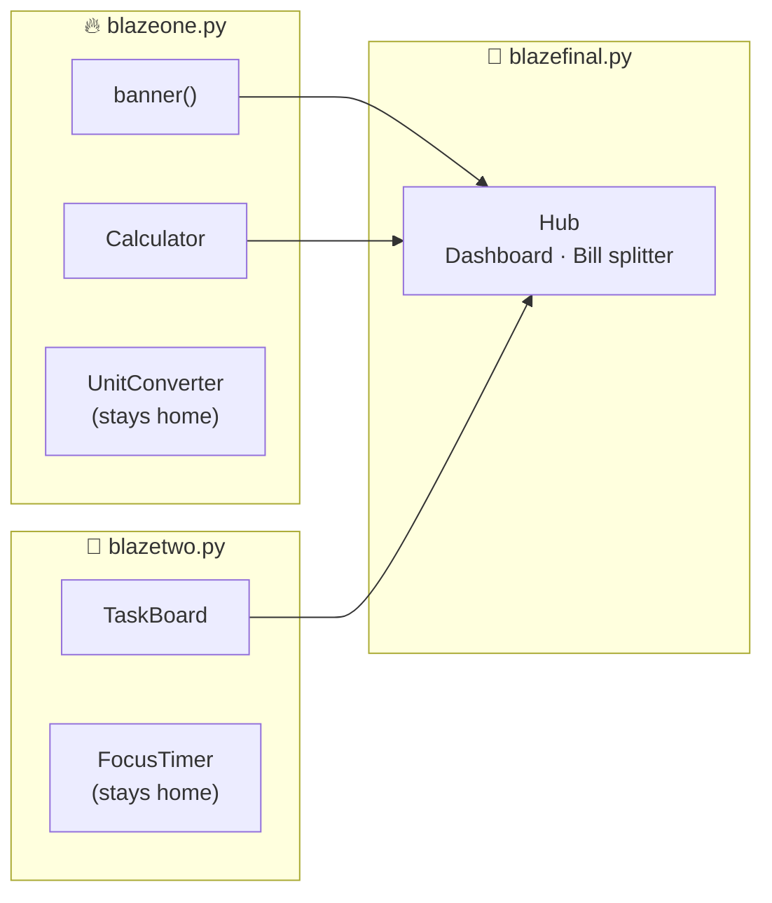

# 🔥 Blaze Demo — Python `from … import …` in action

Three **interactive, colourful terminal apps** that each run on their own — and a third one that is built by **importing pieces from the first two**.

| App | What it does | Theme | Runs standalone? |
|---|---|---|---|
| 🔥 **BlazeOne** (`blazeone.py`) | Smart calculator + unit converter | Fire (red → yellow) | ✅ |
| 🌊 **BlazeTwo** (`blazetwo.py`) | Task board + focus timer | Ocean (blue → aqua) | ✅ |
| 🌌 **BlazeFinal** (`blazefinal.py`) | Productivity hub: dashboard, bill splitter | Aurora (violet → ice) | ✅ |

> **No installs needed** — pure Python standard library. Works on Windows, macOS and Linux (Python 3.8+).

---

## 🧩 How the pieces connect



The only lines that make it happen, at the top of `blazefinal.py`:

```python
from blazeone import banner, Calculator   # 2 components from BlazeOne
from blazetwo import TaskBoard            # 1 component  from BlazeTwo
```

---

## 🚀 Steps to use

### 1. Check Python

```bash
python --version      # or: python3 --version
```

### 2. Put all files in one folder

```
blaze_demo/
├── blazeone.py
├── blazetwo.py
├── blazefinal.py
└── README.md
```

### 3. Open a terminal in that folder

```bash
cd blaze_demo
```

### 4. Run each app

```bash
python blazeone.py      # 🔥 App 1 on its own
python blazetwo.py      # 🌊 App 2 on its own
python blazefinal.py    # 🌌 App 3 — uses parts of App 1 and App 2
```

Pick options by typing the **number** and pressing **Enter**. Type `back` (or press **Ctrl+C**) to leave any screen, `0` to exit an app.

---

## 🎮 Try these

<details>
<summary><b>🔥 BlazeOne — calculator & converter</b></summary>

Choose `1` (Calculator) and type:

```text
calc ❯ 2 * (3 + 4)        → 14
calc ❯ sqrt(16) + ans     → 18      (ans = last result)
calc ❯ 2 ^ 10             → 1024
calc ❯ sin(30)            → 0.5     (degrees)
calc ❯ history            → last 10 calculations
calc ❯ back
```

Choose `2` (Unit converter) → `3` → `100` → **212.00 °F**

</details>

<details>
<summary><b>🌊 BlazeTwo — task board & focus timer</b></summary>

Choose `1` (Task board) and type:

```text
tasks ❯ add Write README !high
tasks ❯ add Buy milk !low
tasks ❯ done 1
tasks ❯ undo 1
tasks ❯ del 2
tasks ❯ clear              (removes finished tasks)
```

Tasks are saved to `blazetwo_tasks.json`, so they're still there next time.

Choose `2` (Focus timer) → type `25` for 25 minutes or `10s` for a quick 10-second demo.

</details>

<details>
<summary><b>🌌 BlazeFinal — the combined hub</b></summary>

| Menu | Powered by |
|---|---|
| 1 Dashboard | BlazeFinal (reads data from Calculator + TaskBoard) |
| 2 Calculator | `Calculator` **imported from BlazeOne** |
| 3 Task board | `TaskBoard` **imported from BlazeTwo** |
| 4 Bill splitter | BlazeFinal, doing its maths with BlazeOne's `Calculator` |
| 5 Under the hood | Shows which file each component came from |

Try the **Bill splitter**: total `1000+200`, tip `10`, people `4` → each pays **330.00**, then press `y` to drop a reminder straight onto the imported task board. Open the **Dashboard** to see both components' data in one place.

BlazeFinal keeps its own tasks in `blazefinal_tasks.json`, separate from BlazeTwo's.

</details>

---

## 🧠 What this demo teaches

<details>
<summary><b>1. <code>from module import name</code></b></summary>

A `.py` file is a **module**. Its file name (without `.py`) is the module name:

```python
from blazeone import Calculator     # bring in one name
from blazeone import banner, Calculator   # bring in several
import blazetwo                     # bring in the whole module …
blazetwo.TaskBoard()                # … and use module.name
```

Python finds `blazeone.py` because it's in the **same folder** as the file you run.

</details>

<details>
<summary><b>2. Why importing doesn't launch the other apps</b></summary>

Each app ends with:

```python
if __name__ == "__main__":
    main()
```

- Run `python blazeone.py` → `__name__` is `"__main__"` → the app starts.
- `from blazeone import …` → `__name__` is `"blazeone"` → `main()` is skipped; you just get the components.

Remove that guard and BlazeOne's menu would pop up the moment BlazeFinal imports it!

</details>

<details>
<summary><b>3. Re-using components with new settings</b></summary>

Imported classes are ordinary objects, so BlazeFinal re-themes them:

```python
calc  = Calculator(accent=141)                                  # violet calculator
board = TaskBoard(storage="blazefinal_tasks.json", accent=147)  # own save file
banner("BlazeFinal", "Productivity Hub", palette=AURORA)        # aurora colours
```

</details>

<details>
<summary><b>4. Use the components in your own script</b></summary>

```python
from blazeone import banner, Calculator
from blazetwo import TaskBoard

banner("My App", "built from Blaze parts")
print(Calculator().evaluate("15% 4 + 2 ** 3"))   # 11

board = TaskBoard(storage="mine.json")
board.add("Learn imports", priority="high")
board.complete(1)
print(board.progress_bar())
```

</details>

---

## 🛠️ Troubleshooting

| Problem | Fix |
|---|---|
| `ModuleNotFoundError: No module named 'blazeone'` | Run from the folder that holds all three files (`cd blaze_demo`). |
| Weird codes like `[38;5;196m` instead of colours | Use **Windows Terminal**, PowerShell 7, VS Code's terminal, or any macOS/Linux terminal. |
| Boxes / icons look broken | Switch to a font with Unicode support (Cascadia Code, Fira Code, JetBrains Mono). |
| Want to reset tasks | Delete `blazetwo_tasks.json` or `blazefinal_tasks.json`. |

---

Made with 🔥 · BlazeOne + 🌊 BlazeTwo = 🌌 BlazeFinal
